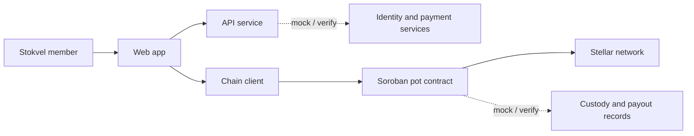

# StockOnChain

> A Stellar and Soroban prototype exploring clearer, rules-based savings pots for South African stokvels.

## 1. Project

- **Live prototype:** [https://stock-on-chain-gmu2.vercel.app/](https://stock-on-chain-gmu2.vercel.app/)
- **Problem:** Shared savings groups need clear records of contributions, balances, and payout rules. StockOnChain explores how software can help make those records easier for members to inspect.
- **Track / focus:** Stellar and Soroban; financial inclusion and tokenization. Confirm the official event track before describing this as an official track entry.
- **Team:** Ntsika and Kea.
- **Owner split:** Kea = product, UX, frontend, market and pitch; Ntsika = Stellar assets, Soroban contract, backend, integrations and deployment. Every issue is reviewed by the other person.
- **Pitch (draft, not user-validated):** StockOnChain is a Testnet prototype exploring clearer records for stokvel contributions and payout rules, with a mock pot used to demonstrate a possible future T-Bill savings flow.
- **Status:** Work in progress. This repository does not claim a production service, live deployment, financial licence, partnership, or real-world backing.

> [!IMPORTANT]
> **Regulatory & Legal Notice:** StockOnChain is an educational research and development prototype deployed exclusively on the **Stellar Testnet**. It **does not constitute legal, regulatory, tax, or investment advice**, nor does it represent an offer or solicitation of securities, collective investment schemes, or financial products. StockOnChain does not currently hold any financial services provider (FSP) license, credit provider license, or banking license from the Financial Sector Conduct Authority (FSCA) or South African Reserve Bank (SARB), nor does it participate in an active regulatory sandbox. Commercial production deployment will require direct engagement with qualified South African legal counsel, formal regulatory approvals, and authorized licensing partners. For complete analysis, review the [Regulatory Compliance Framework](./docs/COMPLIANCE.md).

> [!WARNING]
> **Security & Unaudited Testnet Notice:** All smart contracts, cryptographic attestation modules, demo tokens (`ZATBILL`, `mZAR`), and automation scripts in this repository are **unaudited prototype software** deployed exclusively on the **Stellar Testnet**. They are developed for demonstration purposes only and must **never** be used on Mainnet or with real funds. For full security analysis and known limitations, consult the [Threat Model](./docs/THREAT_MODEL.md).

## 2. Scope

The workspace contains a web app, an API service, a Stellar/Soroban client package, and a Soroban contract. Their end-to-end integration is not asserted here.

## 3. Architecture

The diagram shows the intended prototype flow. Integration and deployment status must be verified before describing any component as live.



## 4. Repository layout and team setup

```text
apps/web/                 Web application
contracts/stokvel-pot/    Soroban contract
docs/                     Project documentation
packages/chain/           Stellar/Soroban client package
scripts/                  Project scripts
services/api/             API service
```

Setup checklist — replace the placeholders with the teammates' names and have each person check off their own setup:

- [x] **Ntsika:** cloned the repository and completed the quickstart below.
- [x] **Kea:** confirmed setup completion.

## 5. Architecture Decisions

The project records architecture decisions in the decision log and keeps them aligned with the Educate & Recommend quality standard.

- [ADR-001 — Stellar core approach and contract architecture](./docs/decisions/ADR-001-stellar-core-and-contract-architecture.md)
- [ADR-002 — Wallet and onboarding experience](./docs/decisions/ADR-002-wallet-and-onboarding-experience.md)
- [ADR-003 — Asset and backing design](./docs/decisions/ADR-003-asset-and-backing-design.md)
- [ADR-004 — Cash-out simulation and local payment rails](./docs/decisions/ADR-004-cash-out-simulation-and-local-payment-rails.md)
- [ADR-005 — Governance and community token deferral](./docs/decisions/ADR-005-governance-and-community-token-deferral.md)

## 6. Partner Ecosystem Map (Production Pathway)

To transition StockOnChain into a legally compliant, commercial production service in South Africa, the platform requires an ecosystem of licensed institutional partners. The matrix below outlines the required partner categories, their operational roles under South African law, verified real-world examples to research, and our current simulated MVP stand-ins:

| Partner Category | Operational Necessity | Verified South African Candidates (For Production) | MVP Stand-in (Testnet Prototype) |
| :--- | :--- | :--- | :--- |
| **1. Licensed Crypto FSP / Intermediary** | Required under FSCA Declaration 135/2022 to lawfully distribute, intermediate, and broker crypto assets to consumers in South Africa. | Luno (FSCA FSP #52471), VALR (FSCA FSP #53308), Sygnia, Altvest Capital | Internal simulated API services; explicit disclaimer of zero financial advice |
| **2. Licensed Asset / CIS Manager** | Required under CISCA to legally manage and structure pooled investor capital into interest-bearing securities. | Prescient Investment Management, Allan Gray, Coronation, Stanlib | Soroban smart contract (`StokvelPot`) simulating automated pro-rata rules |
| **3. Bond Dealer, Custodian & CSDP** | Required under Financial Markets Act to hold legal custody of RSA Government Treasury Bills via Strate (CSD). | Standard Bank CSDP, Nedbank Investor Services, RMB Custody, Absa Investor Services | Synthetic Custodian Ed25519 keypair (`GCUSTODIAN...`) issuing simulated signed statements |
| **4. Trust & SPV Administrator** | Required to establish an insolvency-remote legal structure (SPV/Trust) holding assets for the benefit of stokvel members. | Maitland (Apex Group), Sanne Group (Apex), GMG Trust, Stonehage Fleming | Open-source Soroban smart contract state machine |
| **5. KYC / AML Verification Provider** | Required under FICA Schedule 1 (Item 22) to perform automated ID verification, Home Affairs matching, and sanctions screening. | Smile ID, LexisNexis Risk Solutions SA, PBVerify / Didomi, ThisIsMe | Synthetic Luhn algorithm validator + synthetic OTP verification service |
| **6. Banking & Instant Rail Partner** | Required under NPS Act to clear and settle fiat Rand deposits and instant payouts (PayShap / RTC). | Stitch Money, Peach Payments, Ozow, Capitec Pay, Standard Bank OneHub | Simulated SEP-24 Payout Simulator (`CashoutSimulator.tsx`) |
| **7. Stellar Anchor & Off-Ramp** | Required to provide audited, compliant fiat on/off-ramps and institutional liquidity bridging Stellar to ZAR. | ClickPesa, Yellow Card, Bitmama, licensed South African CASPs | Simulated Anchor API (`services/api/src/sep24.ts`) |
| **8. Regulated ZAR Stablecoin Issuer** | Required to mint fully backed, 1:1 audited digital Rand on the Stellar network under banking regulations. | Future regulated banking consortium or licensed CASP with audited trust account | Testnet Anchor-sim account issuing `mZAR` with zero fiat reserves |
| **9. Specialized Legal & Regulatory Counsel** | Required to structure product documentation, obtain FSCA exemptions, and engage the SARB / IFWG Sandbox. | ENSafrica (Banking & FinTech), Bowmans, Webber Wentzel, Cliffe Dekker Hofmeyr | Internal compliance research documents (`docs/COMPLIANCE.md`, `ADR-005`) |

For comprehensive legal analysis, review the [Compliance Framework](./docs/COMPLIANCE.md) and the [Pitch Deck](./docs/DECK.md).

## 7. Mocked vs. real

This is a placeholder status matrix, not a claim that a component is deployed or backed by a real-world service. Verify each entry against the implementation and authoritative sources before changing its status.

| Component | Status | Notes |
|---|---|---|
| Web app | Prototype deployed | Next.js PWA deployed at [https://stock-on-chain-gmu2.vercel.app/](https://stock-on-chain-gmu2.vercel.app/). See [apps/web/README.md](./apps/web/README.md). |
| API and chain client | To verify | Source folders exist; integration status is not asserted here. |
| Soroban pot contract | Prototype deployed | State-machine pot contract deployed on Testnet (`CBIZM7UPAA7OCRRHSEL43MMDZIKNYQEMB5LB7HZQ32KMV44V6ZW456XM`). Enforces on-chain Ed25519 ProofOfBacking reserve checks (T-07). See [docs/DEPLOYMENTS.md](./docs/DEPLOYMENTS.md) and [docs/POT_RULES.md](./docs/POT_RULES.md). |
| MOCK ZATBILL | Testnet demo token | No real T-bills, reserves, securities, yield, or payout are represented. See [docs/ASSET.md](./docs/ASSET.md). |
| MOCK mZAR | Testnet demo token | Issued only by the Anchor-sim Testnet account. Not backed by fiat; Mainnet ZAR/ZARP assets are not used. See [docs/B-02.md](./docs/B-02.md). |
| Stellar network | To verify | Confirm the configured network and passphrase before use. |
| Identity checks, fiat rails, custody, and payouts | To verify / mock | Do not imply a real provider, licence, reserve, or payout without evidence. |
| Yield or investment returns | Not asserted | No rate or return claim is made in this README. |

### Architecture & Proof of Backing Verification Note (T-07)

Proof of backing is enforced directly on-chain within the Soroban `StokvelPot` smart contract:
- The custodian signs a canonical binary payload using Ed25519 containing the latest verified reserve limit and timestamp.
- The contract verifies the Ed25519 signature via `env.crypto().ed25519_verify()` and stores the latest reserve limit on-chain (`update_attested_reserves`).
- The `invest` function strictly enforces that `zatbill_amount <= get_attested_reserves()`, reverting with `Error::ExceedsAttestedReserves` if an investment exceeds attested backing.
- **Fallback Architecture:** If on-chain cryptographic verification is deferred or bypassed in any deployment mode, the validation check is maintained within the backend API, and all disclosures must state this honestly.

## 8. Quickstart

Prerequisites (install once per machine): Node.js 20 or newer, pnpm 9.15.9, Rust 1.84 or newer with the `wasm32v1-none` target, and Stellar CLI for contract builds. The quickstart command installs Node dependencies and bootstraps Stellar Testnet. Never commit `.env` or put secret keys, API keys, or wallet encryption keys into an AI tool.

```powershell
git clone https://github.com/DyanCoded/StockOnChain.git
Set-Location StockOnChain
Copy-Item .env.example .env
pnpm quickstart

# Optional local validation
pnpm lint
pnpm test
cargo fmt --all -- --check
cargo clippy --workspace --all-targets -- -D warnings
cargo test --workspace
```

`pnpm quickstart` installs dependencies from the lockfile and runs the
testnet-only `pnpm chain:bootstrap` command. Bootstrap generates role keys in the ignored
`.env`, funds them with Friendbot as needed, creates the MOCK asset trustlines,
and deploys and invokes the contract. It updates public keys in
[docs/ACCOUNTS.md](./docs/ACCOUNTS.md); never share or commit `.env`.
To provision the separate ZATBILL Testnet demo asset, deploy the web app to its public HTTPS host, set `STELLAR_HOME_DOMAIN` in `.env` to that host (domain only), then run `pnpm chain:zatbill setup`. Use `pnpm chain:zatbill verify` to exercise authorization, freeze, and clawback. See [docs/ASSET.md](./docs/ASSET.md) for scope and limits.
Run `pnpm chain:mzar` to set the Anchor-sim issuer's home domain and deploy the mZAR Stellar Asset Contract on Testnet. The API faucet requires the Anchor-sim Testnet secret key and issues 100 mZAR per account per 24 hours after the recipient creates its trustline. It is not a SEP-24 service; use one API instance with persistent storage for its local cooldown file (`.local/mzar-faucet-rate-limits.json` by default). See [docs/B-02.md](./docs/B-02.md) for the Mainnet asset research.
`pnpm test` runs Node network-guard tests. Rust contract tests are run separately
with `cargo test --workspace`.

See [CONTRIBUTING.md](./CONTRIBUTING.md) for development guidance and [AI_GUIDELINES.md](./AI_GUIDELINES.md) for G1–G10.

## 9. Smart Contract & Fallback Architecture

The stokvel pot is governed by the `StokvelPot` Soroban smart contract, implementing a 4-state lifecycle (`Open`, `Invested`, `Matured`, `Settled`). Complete plain-language rules, contribution caps, backing verification limits, and pro-rata distribution formulas are documented in [docs/POT_RULES.md](./docs/POT_RULES.md). Deployed contract addresses are recorded in [docs/DEPLOYMENTS.md](./docs/DEPLOYMENTS.md).

- **Fallback Plan (Classic-Only):** If Soroban smart contract operations encounter consensus, RPC, or network blockers, StockOnChain falls back to a Classic Stellar multisig account (2-of-3 threshold among Admin, Custodian, and Dealer) with issuer trustline allowlisting, where pot state transitions and contribution limits are managed and audited by the backend API service.

## 10. User Research

Research status, synthetic personas, interview consent script, current-state hypotheses, wireframe flows, glossary, and the contribute-clock definition are recorded in [docs/RESEARCH.md](./docs/RESEARCH.md). No participant interviews or comprehension tests have been conducted yet; persona details and process pain points are explicitly hypotheses, not findings.

## Live URL

https://stock-on-chain-gmu2.vercel.app/
