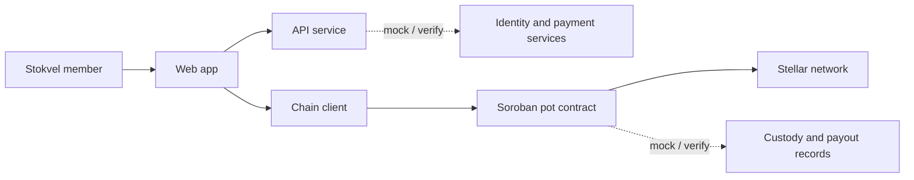

# StockOnChain

> A Stellar and Soroban prototype exploring clearer, rules-based savings pots for South African stokvels.

## 1. Project

- **Problem:** Shared savings groups need clear records of contributions, balances, and payout rules. StockOnChain explores how software can help make those records easier for members to inspect.
- **Track / focus:** Stellar and Soroban; financial inclusion and tokenization. Confirm the official event track before describing this as an official track entry.
- **Team:** Ntsika and Kea.
- **Status:** Work in progress. This repository does not claim a production service, live deployment, financial licence, partnership, or real-world backing.

## 2. Scope

The workspace contains a web app, an API service, a Stellar/Soroban client package, and a Soroban contract. Their end-to-end integration is not asserted here.

## 3. Architecture

The diagram shows the intended prototype flow. Integration and deployment status must be verified before describing any component as live.



## 4. Repository layout and team setup

```text
apps/web/                 Web application
contracts/stokvel-pot/    Soroban contract
docs/                     Project documentation
packages/chain/           Stellar/Soroban client package
scripts/                  Project scripts
services/api/             API service
```

Setup checklist — replace the placeholders with the teammates' names and have each person check off their own setup:

- [x] **Ntsika:** cloned the repository and completed the quickstart below.
- [ ] **Kea:** setup completion not yet confirmed.

## 5. Mocked vs. real

This is a placeholder status matrix, not a claim that a component is deployed or backed by a real-world service. Verify each entry against the implementation and authoritative sources before changing its status.

| Component | Status | Notes |
|---|---|---|
| Web app, API, and chain client | To verify | Source folders exist; integration status is not asserted here. |
| Soroban pot contract | To verify | Contract source is in `contracts/stokvel-pot`; deployment status is unverified. |
| Stellar network | To verify | Confirm the configured network and passphrase before use. |
| Identity checks, fiat rails, custody, and payouts | To verify / mock | Do not imply a real provider, licence, reserve, or payout without evidence. |
| Yield or investment returns | Not asserted | No rate or return claim is made in this README. |

## 6. Quickstart

Prerequisites: Node.js 20, pnpm 9.15.9, Rust 1.84 or newer with the `wasm32v1-none` target, and Stellar CLI for contract builds. Never commit `.env` or put secret keys, API keys, or wallet encryption keys into an AI tool.

```powershell
git clone https://github.com/DyanCoded/StockOnChain.git
Set-Location StockOnChain
Copy-Item .env.example .env
pnpm install
pnpm lint
pnpm test
cargo fmt --all -- --check
cargo clippy --workspace --all-targets -- -D warnings
cargo test --workspace
pnpm chain:bootstrap
```

`pnpm chain:bootstrap` is testnet-only. It generates role keys in the ignored
`.env`, funds them with Friendbot as needed, creates the MOCK asset trustlines,
and deploys and invokes the contract. It updates public keys in
[docs/ACCOUNTS.md](./docs/ACCOUNTS.md); never share or commit `.env`.
`pnpm test` runs Node network-guard tests. Rust contract tests are run separately
with `cargo test --workspace`.

See [CONTRIBUTING.md](./CONTRIBUTING.md) for development guidance and [AI_GUIDELINES.md](./AI_GUIDELINES.md) for G1–G10.
