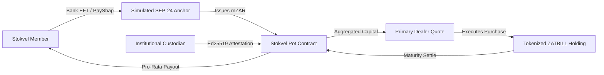

# Pitch Deck: StockOnChain

> **Testnet Prototype & Research Deck**  
> *Rules-based collective savings pots powered by Stellar Soroban and tokenized South African Treasury Bills.*

---

## Slide 1: Title & Hook
- **Product:** StockOnChain
- **Subtitle:** Bringing transparent, rules-based accounting and risk-free Treasury Bill yields to South Africa’s R50+ billion stokvel economy.
- **Built on:** Stellar Network & Soroban Smart Contracts
- **Notice:** Testnet prototype demonstration. No real funds, securities, or banking operations.

---

## Slide 2: The Problem
- **Massive Grassroots Capital:** Over 11.5 million South Africans participate in over 800,000 community stokvels, saving upwards of R50 billion annually.
- **Inflation Drag:** Most stokvels store accumulated cash in standard bank savings accounts earning low real returns below inflation, or in cash boxes vulnerable to theft.
- **Opacity & Manual Administration:** Disagreements regarding contribution amounts, late fees, and pro-rata payout entitlement lead to disputes and loss of community trust.
- **High Institutional Barriers:** Retail savers and informal clubs cannot directly access South African Reserve Bank Treasury Bills due to high minimum bidding thresholds (R100,000+) and complex institutional broker access.

---

## Slide 3: The Solution
- **Rules-Based Smart Pots:** Soroban smart contracts enforce tamper-proof contribution limits, membership rosters, and automated pro-rata settlement without human bias.
- **Fractional Treasury Bill Savings (ZATBILL):** Tokenized 91-day RSA Treasury Bills allow grassroots groups to earn real institutional money-market yields backed 1:1 by sovereign debt.
- **Invisible Blockchain:** Custodial-lite onboarding and sponsored transaction fees eliminate crypto jargon, seed phrases, and gas fees. Members see South African Rand (`R 1 234,50`).
- **Cryptographic Proof of Backing:** Ed25519 digital attestations verified directly on-chain guarantee that every token in circulation is backed 100% by custody-held assets.

---

## Slide 4: Architecture & Flow

---

## Slide 5: Partner Ecosystem & Production Roadmap
To transition from this Testnet prototype to a licensed commercial product, StockOnChain maps each operational role to a verified South African institutional partner category:

| Partner Category | Operational Role | Verified SA Candidates (For Production) | MVP Stand-in (Testnet Prototype) |
| :--- | :--- | :--- | :--- |
| **1. Licensed Crypto FSP** | Compliant product distribution under FSCA Decl. 135/2022 | Luno (FSP #52471), VALR (FSP #53308), Sygnia | Simulated API services; zero financial advice |
| **2. Licensed CIS Manager** | Lawful pooling and portfolio management under CISCA | Prescient, Allan Gray, Coronation, Stanlib | Soroban smart contract (`StokvelPot`) |
| **3. CSDP & Bond Custodian** | Legal custody of RSA Government T-Bills via Strate | Standard Bank CSDP, Nedbank Investor Services, RMB | Synthetic Custodian Ed25519 keypair (`GCUSTODIAN...`) |
| **4. Trust / SPV Administrator** | Insolvency-remote legal ownership for stokvel members | Maitland / Apex Group, Sanne Group, GMG Trust | Open-source Soroban smart contract |
| **5. KYC / Identity Provider** | FICA Schedule 1 (Item 22) Home Affairs ID verification | Smile ID, LexisNexis Risk Solutions SA, PBVerify | Synthetic Luhn ID validator + mobile OTP |
| **6. Instant Payment Rails** | Low-cost PayShap & RTC Rand deposit/withdrawal rails | Stitch Money, Peach Payments, Ozow, Capitec Pay | Simulated SEP-24 Payout Simulator (`CashoutSimulator`) |
| **7. Stellar Anchor / Off-Ramp** | Licensed fiat-to-token bridging and local liquidity | ClickPesa, Yellow Card, licensed local CASPs | Simulated Anchor API (`services/api/src/sep24.ts`) |
| **8. Regulated ZAR Issuer** | 1:1 audited fiat Rand stablecoin issuance on Stellar | Regulated banking consortium / audited trust issuer | Testnet Anchor-sim account issuing `mZAR` |
| **9. Specialized Legal Counsel** | Regulatory filings, FSCA sandbox & SARB FinSurv advice | ENSafrica, Bowmans, Webber Wentzel, CDH | Comprehensive Compliance Framework (`docs/COMPLIANCE.md`) |

---

## Slide 6: Tokenomics & Sound Governance (ADR-005)
- **Zero Speculative Tokens:** No governance, community, or speculative tokens are issued or sold.
- **Why Defer the Historical 75%–80% Community Token Allocation?**
  - Issuing tradable community tokens creates severe securities law and collective investment scheme (CISCA) exposure under South African law.
  - Speculative token volatility directly harms savings club members who require absolute capital preservation.
- **Pure Financial Infrastructure:** The protocol utilizes solely flat units-of-account (`mZAR`) and 1:1 asset-backed Treasury Bill notes (`ZATBILL`).

---

## Slide 7: Regulatory Compliance Posture
- **FSCA / FAIS:** Clear pathway toward partnering with licensed Category I/II Crypto FSPs.
- **FICA & POPIA:** Strict adherence to zero personal data (PII) on-chain or in server logs; phone numbers salted and hashed with SHA-256; automated STOP opt-out compliance.
- **Banks Act Exemption Notice 404:** Designed around the common-bond stokvel exemption with bounded membership and strict deposit caps.
- **Notice:** This presentation is for technical demonstration purposes only and does not constitute financial, legal, or investment advice.

---

## Slide 8: The Ask & Next Steps
- **Target Audience:** South African fintech accelerators, Stellar Community Fund, institutional custody partners, and savings club federations.
- **Next Milestones:**
  1. Engage South African Intergovernmental Fintech Working Group (IFWG) Sandbox.
  2. Pilot with select informal savings clubs in Gauteng & Western Cape under legal supervision.
  3. Integrate live PayShap banking rails via an authorized payment partner.
