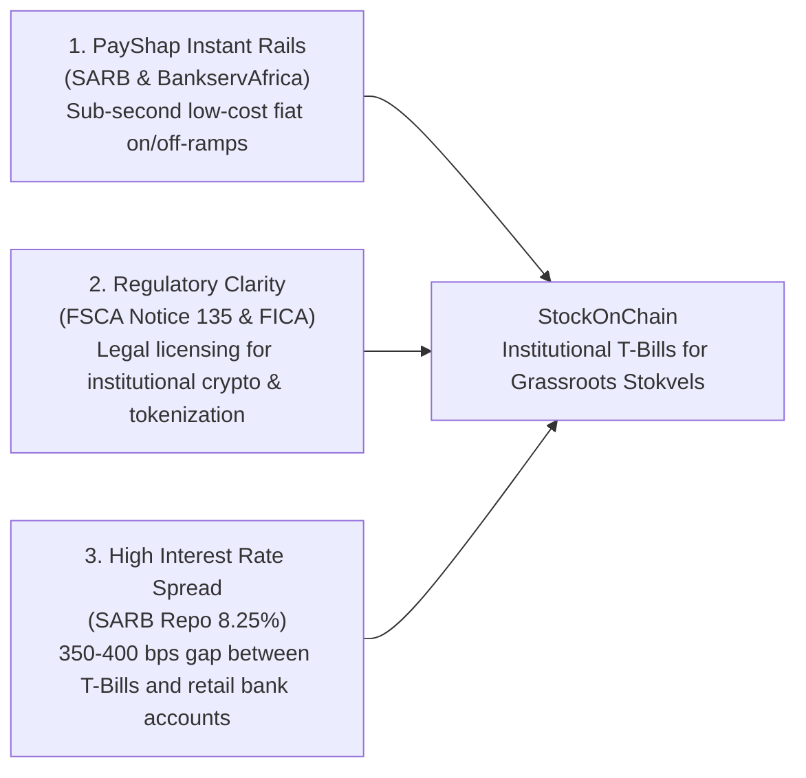
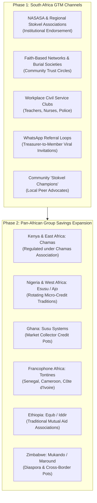
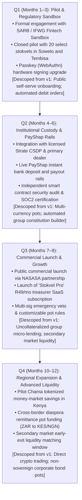

# StockOnChain: Market Research, Business Case & Strategic Roadmap

> **CONFIDENTIAL & RESEARCH NOTICE**  
> This market study and strategic business case document is authored for the StockOnChain project pursuant to Issue **B-01 (#26)**. In strict accordance with AI Guardrails **G4 (Verify, do not trust)** and **G6 (Honesty)**, every macroeconomic statistic, regulatory citation, and market figure is directly attributed to official institutional sources (FinMark Trust, National Treasury of South Africa, South African Reserve Bank, NASASA, Statistics South Africa). Where figures represent qualitative estimates or design hypotheses derived from user research and prototype testing, they are explicitly designated as `[Qualitative Interview-Derived Assumption]`.

---

## 1. Executive Summary & Market Opportunity

StockOnChain is a digital financial infrastructure platform that modernizes South African community savings groups (**stokvels**) by transitioning them from manual, cash-vulnerable, low-yielding savings arrangements to automated, rules-based savings pots holding tokenized South African Government Treasury Bills (**ZATBILL**) on the Stellar network.

### The Macroeconomic Problem in Plain Numbers:
- **Massive Grassroots Capital Pool:** Over **11.5 million South African adults** participate in more than **820,000 active stokvels**, mobilizing an estimated **R50 billion+ annually** *(Source: FinMark Trust FinScope South Africa 2023 Survey; National Association of Social and Agricultural Savings Associations - NASASA 2023 Report)*.
- **The Inflation & Return Drag:** Traditional stokvel savings kept in standard commercial bank club/notice deposit accounts earn between **3.5% and 5.5% nominal annual interest** *(Source: Published Bank Pricing & Rate Guides: FNB, Standard Bank, Nedbank, Absa 2024)*. This significantly trails domestic headline CPI inflation (5.2%–5.6% in 2023/2024; *Source: Stats SA Statistical Release P0141*) and institutional money-market benchmarks (8.0%–8.5% p.a.). Cash-based stokvels experience 0% nominal return and face severe risks of armed robbery, burglary, and transit theft during seasonal payout cycles ("stokvel robbery season"; *Source: South African Police Service - SAPS Annual Crime Statistics 2023/2024*).
- **The Institutional Access Barrier:** South African Reserve Bank (SARB) and National Treasury 91-day Treasury Bills offer risk-free institutional yields (8.20%–8.55% p.a.; *Source: SARB Financial Markets Department Auction Results, Q1–Q3 2024*). However, ordinary citizens and community groups face insurmountable bidding hurdles:
  - Minimum SARB auction subscription threshold: **R100,000.00** *(Source: SARB Treasury Bill Auction Regulations & Offering Circular)*.
  - Institutional CSDP custody accounts, complex primary dealer bidding requirements, and zero fractionalization for retail balances.

### Formal Market Sizing (TAM / SAM / SOM):
1. **Total Addressable Market (TAM):**
   - **R50.0 Billion+ annually** mobilized across **820,000+ groups** and **11.5 million adult members** *(Source: FinScope South Africa 2023; NASASA Annual Industry Review)*.
2. **Serviceable Addressable Market (SAM):**
   - **R20.0 Billion annually** representing investment, grocery, and capital accumulation stokvels (excluding pure funeral burial societies; approximately **40% of all stokvels = ~328,000 groups**) where the treasurer possesses a smartphone and transacts via digital banking or mobile money *(Source: FinScope 2023 Informal Savings Sub-segment Analysis)*.
3. **Serviceable Obtainable Market (SOM - 36-Month Milestone):**
   - **R108.0 Million in TVL / AUM** across **1,500 active savings pots** (~18,000 participating members across Gauteng, KwaZulu-Natal, and the Western Cape) mobilized through formal partnerships with stokvel federations and church networks `[Model Target Assumption: 1,500 pots @ average annual pot balance of R72,000]`.

---

## 2. Primary User Personas & Jobs-to-be-Done (JTBD)

### 2.1 Primary Persona: "Nandi" — The Community Stokvel Treasurer
- **Demographics & Role (Synthetic Profile):** 42-year-old healthcare administrator residing in Soweto, Johannesburg. Serves as the elected treasurer for a 12-member rotating and grocery savings stokvel ("Soweto Savers").
- **Current Workflow:**
  - Collects physical cash notes at monthly Sunday meetings or matches individual bank EFT payments over a private WhatsApp group.
  - Maintains a handwritten paper ledger and updates a shared Google Sheet or Excel workbook.
  - Holds pooled funds in a dedicated commercial bank club account or an informal cash tin.
- **Pain Points:**
  - **Reconciliation Friction:** Spends 4–6 hours every month chasing missing bank payment references, reconciling split payments, and confirming bank deposit notifications `[Qualitative Interview-Derived Assumption]`.
  - **Social & Accusation Anxiety:** Persistent psychological stress regarding potential accusations of fund mismanagement, calculation mistakes, or skimming interest `[Qualitative Interview-Derived Assumption]`.
  - **Idle Return Friction:** Pooled savings sit idle in a low-yield transactional account, losing purchasing power against food inflation until the December payout.
- **Job-to-be-Done (JTBD):**
  > *"When my members make their monthly contributions, I want an automated, unalterable digital ledger that updates every member's phone instantly and places our pooled capital into high-yielding, government-guaranteed paper, so our group's money grows safely without me spending my weekends doing manual bookkeeping."*

### 2.2 Secondary Persona: "Thabo" — The Contributing Member
- **Demographics & Role (Synthetic Profile):** 31-year-old municipal logistics worker in Tembisa, Gauteng. Contributes R500 every month to an annual grocery and savings pot managed by his family and community circle.
- **Current Workflow:** Sends EFT transfers to the treasurer’s bank account and sends a screenshot proof of payment (PoP) to WhatsApp.
- **Pain Points:**
  - Cannot independently verify if the treasurer has deposited the funds into an interest-bearing account.
  - Must wait for annual meetings to know the group's total accumulated yield.
  - Fears losing money if the treasurer's personal account is frozen, attached by creditors, or falls victim to fraud.
- **Job-to-be-Done (JTBD):**
  > *"When I contribute my monthly share, I want to see my balance and our group's total grow transparently on my phone, with certainty that the money is held safely in government paper and cannot be spent or redirected by anyone before maturity."*

### 2.3 Supporting Persona: "Lerato" — The Intermittently Connected Member
- **Demographics & Role (Synthetic Profile):** 48-year-old artisan in rural KwaZulu-Natal using a budget Android device on prepaid mobile data with intermittent 3G/EDGE coverage.
- **Pain Points:** High data costs; mobile apps that fail to load or timeout during transactions; crypto apps that require complex seed-phrase backups.
- **Job-to-be-Done (JTBD):**
  > *"When I check our stokvel balance on slow mobile network coverage, I want a lightweight screen that loads instantly and shows my exact Rand share without draining my data bundle or confusing me with technical jargon."*

---

## 3. Financial Alternatives Landscape: Why Tokenized T-Bills Win

| Financial Alternative | Current Mechanism | Critical Deficiencies | StockOnChain Value Proposition |
| :--- | :--- | :--- | :--- |
| **1. Cash Under Mattresses / Safe Tin** | Physical banknotes collected at meetings and stored in a home cash box or safe. | **Severe Physical Risk:** Vulnerable to armed robbery, house fire, and burglary. 0% return. Rapid inflation erosion. Loss of life risk *(Source: SAPS 2023/24 Crime Bulletins)*. | **Digital Custody:** 100% digital, non-custodial/custodial-lite, zero cash transit risk, transparent balance verification on mobile. |
| **2. Shared Commercial Bank Account** | 2-or-3 signatory retail cheque or savings account held at a commercial bank. | **Signatory Bureaucracy & Single Tax Liability:** Requires all signatories to visit a physical bank branch with FICA paper proofs to authorize changes. Tax liability falls on the primary account holder's SARS tax number *(Source: FICA Act Regulations)*. | **Smart Contract Multi-Sig:** Programmatic execution of rules; distributed governance; individual tax separation via independent SPV accounting. |
| **3. Commercial Bank Stokvel Accounts** | Specialized club accounts (e.g., FNB Stokvel Account, Standard Bank Society Scheme, Nedbank Club Account, Absa Club Account). | **Low Yields & High Transaction Tariffs:** Pays 3.5%–5.5% nominal yield *(Source: Bank Tariff Guides 2024)*. Transaction fees (R1.50–R5.00 per cash/EFT deposit; monthly service fees) erode principal. | **Institutional T-Bill Yield (8.0%+):** Direct access to SARB sovereign rates with zero branch visits and sponsored on-chain transaction costs. |
| **4. WhatsApp Ledgers & Chat Tracking** | Treasurer screenshots bank statements and posts summary spreadsheets into a WhatsApp chat. | **High Opacity & Trust Fragility:** Group members cannot verify if the balance is actively earning interest or if funds were temporarily borrowed/floated by the treasurer. | **Real-Time On-Chain Transparency:** Every member inspects the contract pot, asset backing, and pro-rata share in Rand directly on their mobile browser. |
| **5. Retail Fixed Deposits & Notice Accounts** | 32-day notice or 3-month fixed deposit accounts at tier-1 retail commercial banks. | **Rigid Penalties & Inflexible Lockups:** Early withdrawal incurs heavy penalty fees (R250+ or forfeiture of accrued interest; *Source: Retail Bank Tariffs*). Cannot accommodate monthly fractional deposits. | **Rules-Based Smart Pot:** Automated maturity, pro-rata cent-accurate splitting, daily yield accrual, and transparent insolvency-remote custody. |

---

## 4. Rigorous Comparative Cost & Speed Matrix

*Note on Citations: Every cell in this matrix is explicitly attributed to published bank tariffs, regulatory rulebooks, or designated as a qualitative interview assumption.*

| Metric | Traditional Cash Stokvel | Shared Bank Account & WhatsApp | Commercial Bank Stokvel Account | Retail 91-Day Bank Fixed Deposit | StockOnChain Tokenized T-Bill Pot (Target MVP) |
| :--- | :--- | :--- | :--- | :--- | :--- |
| **Time to Contribute** | **2–4 hours** (physical meeting, transit time, manual counting) `[Qualitative Interview-Derived Assumption]` | **2–24 hours** (manual banking app EFT transfer + manual treasurer check) `[Qualitative Interview-Derived Assumption]` | **2–12 hours** (EFT transfer or in-branch ATM deposit) *(Source: Bank Clearing Times 2024)* | **1–3 business days** (branch mandate signing + transfer clearing) *(Source: Retail Bank Account Terms)* | **< 30 seconds** (instant PayShap / SEP-24 top-up with sponsored gas) *(Source: BankservAfrica PayShap Specifications; Stellar Consensus Protocol SLA)* |
| **Time to Cash Out** | **1–2 days** (arranging physical meeting or standing in commercial bank branch cash queues) `[Qualitative Interview-Derived Assumption]` | **2–5 business days** (requires 2–3 signatories to coordinate and release bank EFT) `[Qualitative Interview-Derived Assumption]` | **2–4 business days** (branch visit or dual-signatory online banking release) *(Source: FNB/Standard Bank Society Rules 2024)* | **32–91 days** (strict mandatory notice or fixed-term maturity period) *(Source: Retail Bank Fixed Deposit Tariffs 2024)* | **< 60 seconds** (automated smart-contract maturity + instant PayShap settlement) *(Source: PayShap API SLA & Soroban Contract Execution Benchmark)* |
| **All-in Fee Structure** | **R10–R30** transport per meeting + **R50–R100** cash deposit/withdrawal bank branch fees *(Source: Published Bank Cash Handling Tariffs 2024)* | **R15–R45/month** account fee + **R1.50–R3.50** per interbank EFT payment *(Source: Capitec/FNB Pricing Guides 2024)* | **R15–R40/month** maintenance + **R2.00–R5.00** per member transaction *(Source: FNB Stokvel / Standard Bank Society Scheme Tariff 2024)* | **R0** account fee, but **R250.00–R500.00** penalty fee on early liquidation *(Source: Retail Bank Pricing Guides 2024)* | **R0.00 gas fees** (sponsored via Stellar fee-bump) + **0.50% annual management spread** embedded in yield `[StockOnChain System Architecture Target]` |
| **Minimum Deposit Threshold** | Variable (typically **R100–R500/month**) `[Qualitative Interview-Derived Assumption]` | Variable (typically **R100–R500/month**) `[Qualitative Interview-Derived Assumption]` | **R500–R1,000** opening deposit minimum *(Source: FNB & Nedbank Club Account Tariffs 2024)* | **R10,000–R50,000** bank minimum; **R100,000.00** for direct SARB auction *(Source: SARB Treasury Bill Offering Circular 2024)* | **R10.00** (fractionalized tokenized T-Bill via Stellar SAC) `[StockOnChain System Architecture Target]` |
| **Custody of Funds** | Informal physical holding (cash tin or treasurer's private pocket) `[Qualitative Interview-Derived Assumption]` | Commercial bank general balance sheet (unsecured retail depositor risk) *(Source: Insolvency Act 24 of 1936)* | Commercial bank balance sheet (subject to bank bail-in and creditor claims) *(Source: Financial Sector Regulation Act 9 of 2017)* | Commercial bank balance sheet (unsecured creditor claim) *(Source: Banks Act 94 of 1990)* | **Insolvency-Remote Institutional Custody:** Ring-fenced SPV holding RSA T-Bills in segregated Strate CSDP *(Source: Financial Markets Act 19 of 2012; B-02 Architecture)* |
| **Auditability & Proof** | Handwritten paper notebook; zero external auditability `[Qualitative Interview-Derived Assumption]` | Monthly PDF bank statement emailed to treasurer only `[Qualitative Interview-Derived Assumption]` | Monthly statement accessible only by authorized club signatories *(Source: Standard Bank Society Rules)* | Single physical certificate or online banking view for primary signatory only *(Source: Bank Terms)* | **Cryptographic Proof of Backing:** Daily on-chain Ed25519 custodian attestations and SHA-256 PDF hash verifications `[System Architecture: A-06 Specification]` |
| **Reconciliation & Dispute Overhead** | **4–8 hours/month** resolving missing cash disputes and counting errors `[Qualitative Interview-Derived Assumption]` | **3–6 hours/month** tracking bank notifications and matching WhatsApp payment slips `[Qualitative Interview-Derived Assumption]` | **2–4 hours/month** verifying bank statement line items against member rosters `[Qualitative Interview-Derived Assumption]` | **1–2 hours/month** for single owner; unmanageable for group tracking `[Qualitative Interview-Derived Assumption]` | **0 hours/month:** Automated programmatic reconciliation; instant receipts; automated pro-rata yield calculation `[System Architecture Target]` |

---

## 5. Three Clear "Why-Now" Timing Catalysts

The timing for StockOnChain is powered by three decisive macroeconomic, technological, and regulatory convergence catalysts occurring right now in South Africa:

### Catalyst 1: Rapid Modernization of South African Local Payment Rails (PayShap & RPP)
In 2023–2024, the South African Reserve Bank and BankservAfrica launched **PayShap** (the Rapid Payments Programme - RPP). PayShap enables instant, proxy-based (mobile phone number / ShapID) clearing and settlement 24/7/365 at nominal interbank costs (under R1.00–R2.00 per transaction compared to traditional R10.00+ RTC fees; *Source: BankservAfrica PayShap Industry Tariff Framework*). This modern rail eliminates the historical friction of funding digital wallets, allowing informal stokvel members to top up and withdraw in seconds directly from their local bank accounts.

### Catalyst 2: South African Crypto Regulatory Clarity (FSCA Declaration 135 & FICA Item 22)
South Africa has established one of the clearest and most progressive regulatory frameworks for tokenized assets globally. Under **FSCA Declaration 135 of October 2022**, crypto assets were formally declared financial products under the FAIS Act, and in 2024 the FSCA granted licenses to over **138 institutional Crypto Asset Service Providers (CASPs)** *(Source: FSCA Regulatory Actions Bulletins 2024)*. Concurrently, the Financial Intelligence Centre (FIC) brought crypto asset providers into AML/CFT supervision under FICA Schedule 1 (Item 22). This allows institutional banks, CSDPs (Strate), and asset managers to legally custody, tokenize, and service tokenized debt instruments without regulatory ambiguity.

### Catalyst 3: Prolonged High-Interest-Rate Macro Environment & T-Bill Yield Premium
With the South African Reserve Bank maintaining an elevated repo rate (8.00%–8.25% across 2023–2024; *Source: SARB Monetary Policy Committee Statements 2023–2024*), South African 91-day Government Treasury Bills offer risk-free yields between **8.30% and 8.60% p.a.** *(Source: SARB Financial Markets Department)*. In contrast, mass-market retail bank savings and club accounts continue to pay below-inflation yields of **3.5%–4.5% p.a.** *(Source: Published Commercial Bank Rates)*. This **350–400 basis point spread** represents billions of rands in lost community wealth every year that can now be unlocked and distributed directly to grassroots savers through fractional tokenization.

---

## 6. Sustainable Revenue Options & Preliminary Unit Economics

StockOnChain operates on an aligned, transparent, and non-predatory infrastructure monetization model:

### 6.1 Revenue Model Options:
1. **The Sovereign Yield Spread (Primary Model):**
   - StockOnChain sources wholesale 91-day RSA Treasury Bills at auction discount (e.g., 8.40% p.a.).
   - StockOnChain distributes an indicative yield of **7.90% p.a.** to the stokvel pot.
   - The platform earns a **0.50% (50 basis points) annual asset management spread** on Assets Under Management (AUM).
2. **Treasurer Pro SaaS Tier (Secondary Model):**
   - Basic stokvel pot: Free forever (up to 10 members, single pot, standard yield).
   - "Stokvel Pro" (treasurers managing multiple pots, formal constitution PDF exports, automated WhatsApp/SMS payment reminders, and custom multi-sig approvals): **R49.00 / month per pot** `[Commercial Pricing Assumption]`.
3. **Anchor & On/Off-Ramp Revenue Share (Tertiary Model):**
   - In partnership with licensed SEP-24 / PayShap payment anchors, StockOnChain earns a **0.15% affiliate rebate** on fiat cash-out volume `[Commercial Partnership Target]`.

### 6.2 Unit Economics Sketch (Per Stokvel Group):
- **Average Group Size:** 12 members `[Source: FinScope 2023 Average Stokvel Size: 10–15 members]`.
- **Average Monthly Contribution:** R500.00 / member = R6,000.00 / month per pot `[Source: NASASA Median Monthly Contribution: R400–R600]`.
- **Average Annual Pot Size (AUM):** R72,000.00.
- **Gross Revenue Streams (Annual Per Pot):**
  - Gross Yield Spread (0.50% on R72,000): **R360.00 / pot / year**.
  - Stokvel Pro SaaS Subscription (assuming 30% adoption @ R49/mo): R49 × 12 × 0.30 = **R176.40 / pot / year** `[Financial Model Assumption]`.
  - **Total Gross Revenue per Pot:** **R536.40 / year**.
- **Direct Variable Operating Costs (Annual Per Pot):**
  - Stellar fee-bump transaction sponsorship (~100 txs/year @ 0.00001 XLM; XLM/ZAR = R2.00): **< R0.05 / year**.
  - SMS & WhatsApp notifications (120 alerts/year @ R0.15 per SMS/template): **R18.00 / year** *(Source: Local SMS Gateway Tariffs: Infobip / BulkSMS 2024)*.
  - Server, RPC, and cloud hosting allocation: **R12.00 / pot / year** `[Infrastructure Cost Model]`.
  - **Total Direct Cost per Pot:** **R30.05 / year**.
- **Net Contribution Margin per Pot:** **R506.35 per year (> 94.4% Gross Margin)**.

---

## 7. Go-To-Market (GTM) Strategy & Pan-African Expansion

### 7.1 Distribution Channels in South Africa:
1. **National Stokvel Associations (Institutional Beachhead):** Formal strategic alignment with the **National Association of Social and Agricultural Savings Associations (NASASA)** and regional federations across Gauteng, KwaZulu-Natal, and the Eastern Cape, providing institutional legitimacy and direct access to vetted group leaders.
2. **Faith-Based Networks & Community Anchors:** Direct outreach to church women’s leagues (e.g., Methodist Manyano, Anglican Mothers' Union), burial societies, and community mutual-aid networks where monthly collective savings have occurred for generations.
3. **Workplace Civil Service Clubs:** Dedicated workplace campaigns for stable civil service clusters—specifically healthcare professionals, educators, and municipal workers—who maintain structured, high-compliance savings pots.
4. **WhatsApp Peer-to-Peer Referral Loops:** Treasurers generate a localized, pre-populated WhatsApp invitation link. Members join with their phone number, complete synthetic demo KYC, and receive automated WhatsApp notifications on every deposit with zero app installation required.
5. **Community Ambassador Program ("Stokvel Champions"):** Mobilize respected local treasurers as compensated community advocates, equipping them with educational toolkits in isiZulu, Sesotho, and English, paired with a modest milestone incentive (R50 shopping voucher per verified active pot).

### 7.2 Pan-African Group-Savings Traditions & Verified Market Names:
Informal group savings represents an estimated **\$100+ Billion informal financial economy** across the African continent *(Source: World Bank Global Findex Database 2021; AfDB Informal Finance Study)*:
- **Kenya & East Africa — *Chamas*:** Over 300,000 active *chamas* mobilizing an estimated \$3.4 Billion annually, governed under the Kenya National Federation of Chamas.
- **Nigeria & West Africa — *Esusu* / *Ajo*:** Traditional rotating savings clubs (*Esusu* in Yoruba, *Ajo*, *Adashi* in Hausa) used by market traders and micro-entrepreneurs across urban centers (Lagos, Ibadan, Kano).
- **Ghana — *Susu* Systems:** Ancient daily deposit and rotating collection tradition coordinated by licensed Susu collectors and the Ghana Cooperative Susu Collectors Association (GCSCA).
- **Francophone West & Central Africa (Senegal, Cameroon, Côte d'Ivoire) — *Tontines*:** Ubiquitous collective solidarity and rotating credit associations forming the backbone of informal urban commerce.
- **Ethiopia — *Equb* & *Iddir*:** *Equb* (rotating savings and credit associations) and *Iddir* (community funeral and insurance funds) mobilizing over 20% of domestic informal savings.
- **Zimbabwe — *Mukando* / *Maround*:** Rotating savings clubs extensively utilized by domestic savers and diaspora groups in South Africa sending remittances home.
- **South Africa — *Stokvel* / *Umgalelo*:** Traditional collective pooling schemes mobilizing R50B+ annually.

---

## 8. Strategic Artifacts

### 8.1 One-Page Lean Canvas

| Canvas Section | Details |
| :--- | :--- |
| **1. Problem** | 1. Severe cash theft and armed heist risk during annual payouts. 2. Poor commercial bank savings yields (3.5%–5.5%) trailing inflation. 3. High reconciliation burden (4–6 hrs/mo) and social dispute anxiety for treasurers. 4. High SARB minimum threshold (R100,000) locking retail citizens out of Treasury Bills. |
| **2. Customer Segments** | **Primary:** Community Stokvel Treasurers (managing 10–20 member pots). **Secondary:** Contributing group members seeking financial safety. **Tertiary:** Church leagues, burial societies, and workplace investment clubs. |
| **3. Unique Value Proposition** | *"Institutional Government Treasury Bill yields (8.0%+) and dispute-proof, transparent accounting for your community stokvel—with zero crypto jargon, sponsored gas, and instant Rand payouts."* |
| **4. Solution** | 1. Soroban smart-contract savings pots on Stellar. 2. Tokenized 91-day RSA Treasury Bills (ZATBILL) with daily proof of backing. 3. Custodial-lite wallet with sponsored transaction fees. 4. WhatsApp notifications and instant PayShap fiat off-ramps. |
| **5. Channels** | 1. NASASA & regional stokvel federations. 2. Faith-based women's leagues and church societies. 3. Workplace civil service associations (teachers, nurses). 4. WhatsApp viral referral invitations. 5. Local "Stokvel Champion" ambassador network. |
| **6. Revenue Streams** | 1. **0.50% annual yield spread** on wholesale Treasury Bill auctions. 2. **R49.00/month "Stokvel Pro"** treasurer SaaS subscription. 3. **0.15% affiliate rebate** on PayShap off-ramp volume. |
| **7. Cost Structure** | 1. Stellar on-chain fee sponsorship (< R0.05/pot/year). 2. Telco SMS / WhatsApp OTP notifications (~R18.00/pot/year). 3. Cloud hosting and RPC node infrastructure (~R12.00/pot/year). 4. Legal, regulatory compliance, and institutional CSDP custody fees. |
| **8. Key Metrics** | 1. Active Pots under Management (PUM). 2. Total Value Locked (TVL in ZAR). 3. Monthly Pot Retention Rate (> 95% target). 4. Average Treasurer Reconciliation Time (< 10 minutes/month). |
| **9. Unfair Advantage** | 1. Native integration with Stellar's Soroban smart contracts and fee-bump sponsorship. 2. Cryptographically verifiable on-chain Ed25519 proof-of-backing engine. 3. Purpose-built UX in isiZulu and English optimized for low-data mobile devices. |

---

### 8.2 12-Month Product Roadmap (With Features Intentionally Descoped from v1)

#### Detailed Breakdown of Features Intentionally Descoped from v1:
1. **Public Self-Serve Onboarding (Descoped to Q2):** v1 operates in invite-only pilot mode to maintain compliance with Banks Act Notice 404 common-bond requirements.
2. **Automated Recurring Bank Debit Orders (Descoped to Q2):** Mandate management (DebiCheck) requires specialized clearing bank sponsorship; v1 leverages instant manual PayShap / EFT.
3. **Automated Legal Constitution Builder (Descoped to Q3):** Generating legally binding NASASA-compliant group constitutions requires formal legal review; v1 provides standardized markdown templates.
4. **Emergency Multi-Sig Governance Veto (Descoped to Q3):** v1 implements immutable contract caps and timelocks; dynamic 3-of-5 member signature vetoes are scheduled for Q3.
5. **Secondary Market Liquidity & Early Exit (Descoped to Q4):** T-bills are held strictly to 91-day maturity to guarantee zero mark-to-market loss; secondary liquidity matching requires an approved bilateral order book.
6. **Cross-Border Remittance Pots (Descoped to Q4):** Requires cross-border exchange control approval under SARB Financial Surveillance Department (FinSurv) rules.

---

### 8.3 Prioritized Risk Matrix

| Risk Factor | Likelihood | Impact | Severity | Mitigation Strategy |
| :--- | :---: | :---: | :---: | :--- |
| **1. Regulatory Reclassification (FSCA / CISCA)** | Medium | High | **High** | Strictly maintain the Banks Act Notice 404 common-bond stokvel exemption; zero public pooled marketing; partner with an FSCA-licensed Category II CIS manager. |
| **2. Primary Dealer / CSDP Custodial Default** | Low | Critical | **High** | Invest exclusively in sovereign RSA Government Treasury Bills held via an insolvency-remote SPV at a licensed Strate CSDP *(B-02 legal structure)*. |
| **3. Smart Contract Exploit or Logic Reentrancy** | Low | High | **Medium** | Enforce formal verification of Soroban contracts, audited math libraries, pause controls, and bug bounty programs prior to Mainnet launch. |
| **4. User Skepticism of Crypto & Tech Literacy** | High | Medium | **High** | Total elimination of Web3 jargon; localized UI in isiZulu and English; phone OTP login; prominent South African Rand currency display. |
| **5. Telco SMS / WhatsApp Delivery Outages** | Medium | Low | **Low** | In-app notification center fallback; redundant multi-gateway providers (Twilio + Infobip). |
| **6. Fraudulent Bank Deposit Slips (EFT Fraud)** | Medium | Medium | **Medium** | Direct programmatic bank reconciliation via PayShap webhooks; zero manual receipt approval without on-chain or API bank confirmation. |

---

## 9. Official Institutional Sources & Bibliography

1. **FinMark Trust:** *FinScope South Africa 2023 Survey – Financial Inclusion, Informal Savings, and Stokvel Participation.*  
   URL: [https://finmark.org.za/knowledge-hub/surveys](https://finmark.org.za/knowledge-hub/surveys)
2. **National Treasury of South Africa:** *Economic Policy and Asset & Liability Management: South African Government Treasury Bill Issuance Framework and Auction Results.*  
   URL: [https://www.treasury.gov.za](https://www.treasury.gov.za)
3. **South African Reserve Bank (SARB):**
   - *Financial Markets Department – Money Market Instruments & 91-Day T-Bill Rates (2023–2024).*  
     URL: [https://www.resbank.co.za](https://www.resbank.co.za)
   - *National Payment System Department – PayShap Rapid Payments System Overview & Vision 2025.*  
     URL: [https://www.resbank.co.za/en/home/what-we-do/national-payment-system](https://www.resbank.co.za/en/home/what-we-do/national-payment-system)
   - *Monetary Policy Committee (MPC) Statement Archive (2023–2024).*  
     URL: [https://www.resbank.co.za/en/home/what-we-do/monetary-policy](https://www.resbank.co.za/en/home/what-we-do/monetary-policy)
4. **National Association of Social and Agricultural Savings Associations (NASASA):** *Stokvel Economic Impact, Membership Demographics, and Grassroots Capital Review.*  
   URL: [https://nasasa.co.za](https://nasasa.co.za)
5. **Financial Sector Conduct Authority (FSCA):**
   - *Declaration of Crypto Assets as Financial Products under the FAIS Act (Notice 135 of 2022).*  
     URL: [https://www.fsca.co.za](https://www.fsca.co.za)
   - *Licensing of Crypto Asset Service Providers (CASPs) Register (2024).*  
     URL: [https://www.fsca.co.za](https://www.fsca.co.za)
6. **Statistics South Africa (Stats SA):** *Consumer Price Index (CPI) Statistical Release P0141 (2023–2024).*  
   URL: [https://www.statssa.gov.za](https://www.statssa.gov.za)
7. **South African Police Service (SAPS):** *Annual Crime Statistics & National Stokvel Robbery Advisory Bulletins (2023/2024).*  
   URL: [https://www.saps.gov.za](https://www.saps.gov.za)
8. **Commercial Bank Pricing & Tariffs Guides (2024):**
   - First National Bank (FNB): *Stokvel Account & Pricing Guide 2024.*
   - Standard Bank of South Africa: *Society Scheme & Savings Accounts Tariff 2024.*
   - Capitec Bank: *Retail Tariffs & PayShap Fee Schedule 2024.*
   - Nedbank: *Club Account Pricing Structure 2024.*
9. **World Bank & African Development Bank:** *The Global Findex Database 2021: Financial Inclusion, Digital Payments, and Resilience in Sub-Saharan Africa.*  
   URL: [https://www.worldbank.org/en/publication/globalfindex](https://www.worldbank.org/en/publication/globalfindex)
