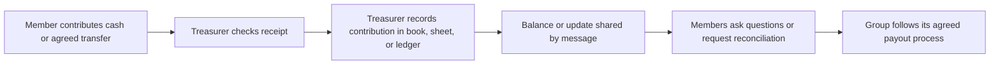

# D-01 Research, Personas and Flows

**Status:** Research plan and prototype hypotheses only. As of 2026-11-13, no member interviews or surveys have been conducted, no findings or cost figures are verified, no comprehension test has run, and no Figma file has been published.

**Figma:** Not published. The following text wireframes are review aids, not a Figma deliverable. Add the real, access-checked Figma URL here after the design owner creates and publishes the file.

## Research Integrity

- Every persona below is **synthetic** and is not based on an interview or a real person.
- Statements marked **hypothesis** are questions to investigate, not claims about stokvel members.
- Do not add quotations, prevalence, costs, or conclusions until they are supported by actual participant input.
- Store no participant names, contact details, group names, exact savings amounts, account/payment details, IDs, locations, audio, or video in prompts, notes, or this repository.
- Do not recruit or interview anyone under 18 for this prototype research.

## Personas

### 1. Primary: The Treasurer

**Synthetic persona: “Nandi”**

Nandi coordinates contributions and communicates the group balance. This is a role-based prototype persona, not a description of a known person.

**Needs (hypotheses):** reconcile contributions; show members the same understandable record; explain what is and is not backed; correct an entry without losing the audit trail.

**Concerns to validate:** being blamed for record differences; time spent reconciling; who may authorize payments; whether members understand maturity and custody risk.

**JTBD:** When a contribution is made, I want a clear, reviewable record linked to the group rules, so I can reconcile the pot and answer member questions without relying on memory or private messages.

### 2. Secondary: The Ordinary Member

**Synthetic persona: “Thabo”**

Thabo contributes to a group managed by someone else and wants to verify the amount recorded for him. No age, income, savings amount, location, or actual group data is implied.

**Needs (hypotheses):** confirm a contribution; inspect the total and payout rules; understand when funds may not be accessible.

**Concerns to validate:** whether a digital record is trustworthy; whether the T-Bill and custodian are real; what happens if a transaction or key is lost.

**JTBD:** When I contribute, I want to see what the group recorded and how the rules work, so I can check my share without asking the treasurer to privately explain every update.

### 3. Supporting: The Intermittently Connected Member

**Synthetic persona: “Lerato”**

Lerato represents a design scenario where connectivity or data is limited. This is a test case, not a claim about a real user segment or device ownership.

**Needs (hypotheses):** load essential balances and explanations quickly; see a clear last-known state; know whether an action completed before retrying.

**Concerns to validate:** duplicate contributions after a timeout; relying on color or dense text; being unable to read the risk disclosure on a small screen.

**JTBD:** When my connection is slow or drops, I want a small, explicit confirmation state, so I can tell whether I need to retry without accidentally repeating an action.

## Journey Maps (Hypotheses To Validate)

### Treasurer: Reconcile a Contribution

| Stage     | Current action (hypothesis)                   | Question / risk                                | Prototype opportunity                                                         |
| --------- | --------------------------------------------- | ---------------------------------------------- | ----------------------------------------------------------------------------- |
| Receive   | Member sends cash or a transfer               | How does the treasurer know it arrived?        | Show a clear pending state; never call a pending transfer complete.           |
| Record    | Treasurer updates a book, sheet, or message   | What fields are essential and who checks them? | Receipt with date, amount, member reference, and status; synthetic data only. |
| Reconcile | Compare the record with cash or bank activity | How are differences resolved today?            | Separate recorded, confirmed, and disputed states.                            |
| Report    | Share a balance or payout rule                | What do members need to see?                   | Shared ledger view with rule and risk disclosure.                             |

### Ordinary Member: Check a Contribution

| Stage      | Current action (hypothesis)                       | Question / risk                                      | Prototype opportunity                                                  |
| ---------- | ------------------------------------------------- | ---------------------------------------------------- | ---------------------------------------------------------------------- |
| Contribute | Give cash or use a group-agreed transfer route    | What confirmation is expected?                       | Plain-language contribution flow; clock begins at the action.          |
| Confirm    | Wait for the treasurer or group update            | How long is acceptable, and what causes uncertainty? | Status uses text and icon, not color alone.                            |
| Inspect    | Ask for or read a shared record                   | Which rules are difficult to understand?             | Balance, membership, cap, maturity, and claim rules in plain language. |
| Decide     | Continue, question, or leave funds until maturity | Does the user understand access and yield risk?      | Explain risks before confirmation; do not imply guaranteed returns.    |

### Intermittently Connected Member: Recover From a Slow Request

| Stage   | Current action (hypothesis)             | Question / risk                                | Prototype opportunity                                                            |
| ------- | --------------------------------------- | ---------------------------------------------- | -------------------------------------------------------------------------------- |
| Open    | Load the dashboard on a slow connection | Which content is essential first?              | Static shell, local CSS, no remote font/image requests.                          |
| Start   | Begin an action, then connection stalls | Can the user distinguish pending from failed?  | Persistent text status and disabled repeat action while pending.                 |
| Recover | Reconnect or reopen the page            | What information can safely be shown as stale? | Mark cached information as last known; never replay a transaction automatically. |
| Verify  | Check final result                      | What counts as an adequate receipt?            | Explicit final status and a Testnet transaction reference where applicable.      |

## Interview and Survey Plan

**Target:** 3–5 adult stokvel members or treasurers. Recruitment and consent must be voluntary. Seek a mix of the treasurer role and ordinary members; do not collect demographic details unless a later approved protocol demonstrates they are essential.

**Consent script (read before taking notes):**

> We are testing an early software prototype and asking about how group savings are organized. Taking part is voluntary. Please do not share your name, group name, contact details, account details, ID, exact savings amounts, or anything you want kept private. We will not record audio or video. We will keep only anonymous notes about general processes and product feedback, and will not include identifying quotes. You may skip any question or stop at any time. Do you agree to continue?

If the participant does not explicitly agree, stop and retain no notes. Record consent only as an aggregate count, not alongside a person-level record.

**Questions (10–15 minutes):**

1. Think about the last time your group collected contributions. What steps happened from the member paying to the group recording it?
2. How does the group save or hold contributions today (for example cash, a shared account, or another arrangement)? Do not give account names or amounts.
3. How do you move or confirm money between members and the group? What confirmation do you see?
4. What parts of keeping or checking the records take effort or cause disagreement? Can you describe the process without naming people or groups?
5. What would worry you about money being held by a custodian or represented by a T-Bill? Which facts would you need before deciding whether to trust such an arrangement?
6. How would a maturity date or funds being unavailable until maturity affect your decision?
7. What do you think “indicative, not guaranteed yield” means? Please explain it in your own words.
8. What would you expect to happen if a transaction went to the wrong address or a wallet key was lost?
9. After reading the prototype disclosure, what do you believe is real today and what is simulated?
10. Which record or confirmation would help you most, and why?

**Note form (anonymous, no quotations):**

| Session       | Role (treasurer/member) | Existing process themes | Concerns raised | Trust conditions | Comprehension gaps | Design implication |
| ------------- | ----------------------- | ----------------------- | --------------- | ---------------- | ------------------ | ------------------ |
| Not conducted | —                       | —                       | —               | —                | —                  | —                  |

Current interview count: **0 / 3–5**. No interview synthesis is available. If a note could identify a participant or group, remove it before saving. Do not place raw notes or any participant data in AI prompts.

## Current-State Process Map (Hypotheses)

No interviews have confirmed this process. It is a discussion guide, not a description of all stokvels.

| Possible pain point                                      | Evidence status                         | Cost / measure                                 |
| -------------------------------------------------------- | --------------------------------------- | ---------------------------------------------- |
| Manual reconciliation or duplicate entries               | Hypothesis; ask how often and why       | Not measured; do not infer time or money cost. |
| Members cannot independently see the same current record | Hypothesis; ask what members can access | Not measured.                                  |
| Cash or transfer confirmation is ambiguous               | Hypothesis; ask what counts as proof    | Not measured.                                  |
| Payout and maturity rules are difficult to explain       | Hypothesis; test comprehension          | Not measured.                                  |

## Lo-Fi Wireframe Inventory

These are content-level flow sketches for design review; they are not Figma wireframes and do not claim user validation. Every screen must label Testnet and mock components where they appear.

### 1. Verify

`Welcome → explain what verification is and is not → collect only required fields → consent → pending / approved / needs-help state → show next step.`

Do not present the prototype as a real identity check or store real ID data in research fixtures.

### 2. Contribute

`Choose group → show amount and remaining cap → show Testnet/mock notice → review amount → confirm → pending → completed receipt OR explicit failed/cancelled state.`

### 3. Track

`Group summary → recorded contributions → confirmed/pending/disputed status → rule and maturity summary → last-updated time.`

### 4. Redeem

`Show maturity and eligibility → explain simulated claim vs. real redemption → review share and deductions → confirm → pending → completed / failed receipt.`

### 5. Cash Out

`Select simulated rail → show mZAR mock label and no-fiat warning → review recipient and amount → confirm → simulated status → clear completion or failure.`

### 6. Proof of Backing

`Asset disclosure → show issuer and network → show whether an attestation is present → explain what its hash can and cannot prove → show custodian/backing status as not connected unless verified.`

## Plain-Language Glossary

| Term        | Plain-language meaning                                                                                                               |
| ----------- | ------------------------------------------------------------------------------------------------------------------------------------ |
| Stokvel     | A group that saves together under rules agreed by its members.                                                                       |
| Treasurer   | A member who helps record contributions and share group updates.                                                                     |
| T-Bill      | A short-term government borrowing instrument. This prototype does not hold a real T-Bill.                                            |
| Custodian   | An organization responsible for holding assets for someone else. No custodian is connected to this demo.                             |
| Maturity    | The date when a financial instrument is scheduled to end or become payable under its terms.                                          |
| Yield       | A possible return on an investment; it can change and is not guaranteed. This demo pays no real yield.                               |
| Testnet     | A separate Stellar network for development and testing. Its demo tokens have no real-world value.                                    |
| Wallet key  | Secret information that controls a wallet. A lost or exposed key may not be recoverable.                                             |
| Trustline   | A Stellar account's authorization to hold a particular issued asset.                                                                 |
| Mock asset  | A token used to demonstrate software behavior; it is not backed by real money or securities.                                         |
| Attestation | A signed statement by a named party. A hash can help check whether a document changed; it does not prove that the statement is true. |
| Soroban     | Stellar's smart-contract platform.                                                                                                   |

## Pitch and Buy-In Clock

**Pitch (draft, not user-validated):** “StockOnChain is a Testnet prototype exploring clearer records for stokvel contributions and payout rules, with a mock pot used to demonstrate a possible future T-Bill savings flow.” This wording is consistent with the current mock/Testnet state; interviews have not validated its clarity or appeal.

**Target clock:** “Buy in under 2 minutes” is a future usability target, not a measured result.

- Start: the participant's first tap/click on **Contribute** after the prototype is loaded and the participant is already in the selected group.
- End: the final successful confirmation/receipt is visibly rendered.
- Include: amount review, risk disclosure, any in-flow confirmation or wallet approval, and time waiting for the result.
- Exclude: moderator instructions and time before the first Contribute action. Do not exclude required authentication if a future design places it inside the contribution flow; define that separately before testing.
- Record completion, elapsed wall-clock time, errors, retries, cancellation, and whether the participant can explain what they confirmed. A cancelled, failed, or incomplete flow is not a successful under-two-minute completion.
- No timing study has been run. Report results only after observed sessions; do not turn this target into a current capability claim.

## Design Changes and Evidence Trace

The following are prototype choices, not findings. No interview-derived design changes can be claimed until the interview table contains verified findings.

| Current choice                                                        | Intended concern                                               | Evidence source                                   | Status                                             |
| --------------------------------------------------------------------- | -------------------------------------------------------------- | ------------------------------------------------- | -------------------------------------------------- |
| Use text labels such as “Not connected” beside each flow stage        | Avoid implying a real T-Bill or using color as the only signal | D-02 prototype requirement; no interview evidence | Implemented; validate with participants            |
| Show maturity, non-guaranteed yield, and key-loss risks before action | Make material risks visible before a decision                  | D-02/ADR-003 requirements; no interview evidence  | Implemented as explainer; comprehension not tested |
| Keep the dashboard static, local-asset-only, and usable at 360px      | Support low-data access and small screens                      | D-02 requirement; no participant evidence         | Implemented; device/network research pending       |

Confirmed interview-traced changes: **0**. D-01 is not Done until at least three changes are linked to actual participant findings and reviewed without storing personal data.

## Pending D-01 Evidence

- [ ] Conduct 3–5 consented interviews or surveys with adult stokvel members/treasurers.
- [ ] Record only anonymous process themes; store no personal data, exact amounts, quotes that could identify someone, or contact details.
- [ ] Map pain points and costs only where a participant provides a verifiable account; otherwise label the measure unavailable.
- [ ] Create and publish the six-flow Figma file; add its real URL above after checking access permissions.
- [ ] Obtain fluent-speaker review of all isiZulu research and UI copy; record reviewer approval without retaining unnecessary personal data.
- [ ] Run comprehension sessions and link at least three design changes to actual findings.
- [ ] Revisit the pitch after user validation and preserve its Testnet/mock limitations.
